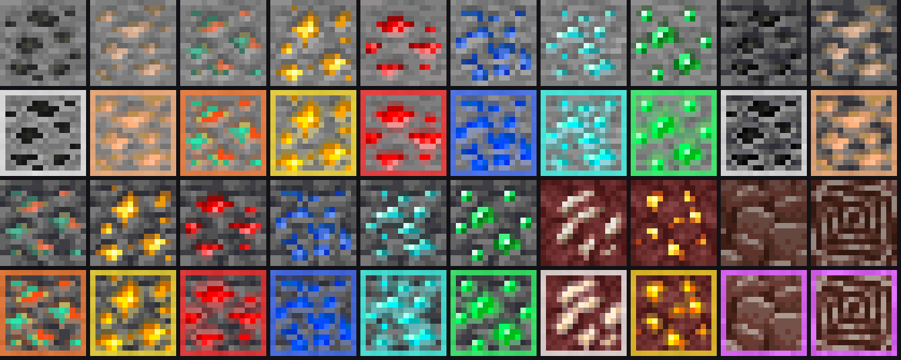

# Ore Glow + TreeVein สำหรับ Minecraft Bedrock

มี 2 แพ็ค แยกกันเพื่อให้โลกหลักยังเก็บอาชีพเม้นได้

| ไฟล์ | ทำอะไร | อาชีพเม้น |
|---|---|---|
| `dist/OreGlow_RP.mcpack` | แร่สีสด มีกรอบสีรอบบล็อก มองเห็นจากไกล ถ้าเปิด Vibrant Visuals แร่จะเรืองแสงจริง | **ยังได้** (เป็น Resource Pack) |
| `dist/TreeVein_BP.mcpack` | ย่อตัว + ขวาน = ตัดทั้งต้น, ย่อตัว + อีเตอร์ = ขุดทั้งสายแร่ | **ปิดถาวรในโลกที่เปิดใช้** (เป็น Behavior Pack) |

ต้องใช้เกม 1.21.120 ขึ้นไป (26.62 ใช้ได้)

แถวบนเป็นภาพเดิมของเกม แถวล่างเป็นภาพหลังลงแพ็ค Ore Glow

## 1. นำเข้าแพ็คลงเกม

**Android**
1. ดาวน์โหลดไฟล์ `.mcpack` ทั้ง 2 ไฟล์
2. เปิดแอป Files หรือ Downloads แล้วแตะที่ไฟล์ เลือกเปิดด้วย Minecraft
3. เกมจะเปิดขึ้นมาและขึ้นข้อความ "Successfully imported" ให้ทำซ้ำกับอีกไฟล์

**iPhone / iPad**
1. ดาวน์โหลดไฟล์ `.mcpack` แล้วบันทึกลงแอป Files
2. เปิดแอป Files กดค้างที่ไฟล์ แล้วเลือก แชร์ (Share) → Minecraft
3. เกมจะเปิดขึ้นมาและนำเข้าไฟล์ให้ ทำซ้ำกับอีกไฟล์

แค่นำเข้ายังไม่กระทบอาชีพเม้น จะมีผลก็ต่อเมื่อเปิดใช้ Behavior Pack ในโลกไหนสักโลก

## 2. เปิดใช้ Ore Glow (อาชีพเม้นยังได้)

ทำได้ 2 แบบ
- **ใช้กับทุกโลก:** ตั้งค่า (Settings) → ทรัพยากรส่วนกลาง (Global Resources) → My Packs → Ore Glow → เปิดใช้งาน (Activate)
- **ให้เพื่อนเห็นด้วยโดยไม่ต้องลงเอง:** แก้ไขโลก (Edit World) → แพ็คทรัพยากร (Resource Packs) → Ore Glow → เปิดใช้งาน เพื่อนที่เข้าโลกจะได้แพ็คนี้อัตโนมัติ

**อยากให้แร่เรืองแสงจริง:** ตั้งค่า → วิดีโอ (Video) → โหมดกราฟิก (Graphics Mode) → Vibrant Visuals (มีเฉพาะเครื่องที่รองรับ)

## 3. เปิดใช้ TreeVein (อาชีพเม้นของโลกนั้นจะปิด)

แนะนำให้เปิดในโลกที่ไม่ได้ตั้งใจเก็บอาชีพเม้น หรือก๊อปโลกก่อน (แก้ไขโลก → คัดลอกโลก (Copy World)) แล้วค่อยเปิดในโลกที่ก๊อปมา

1. แก้ไขโลก (Edit World) หรือสร้างโลกใหม่
2. แพ็คพฤติกรรม (Behavior Packs) → TreeVein → เปิดใช้งาน
3. เกมจะเตือนว่าอาชีพเม้นจะถูกปิด ให้กดยืนยัน ไม่ต้องเปิดโหมดทดลอง (Experiments)

เพื่อนที่เข้ามาเล่นในโลกนี้ใช้ได้เลยโดยไม่ต้องลงอะไร แต่จะไม่ได้อาชีพเม้นในโลกนี้เหมือนกัน

## วิธีใช้ในเกม

- **ตัดทั้งต้น:** ย่อตัวค้างไว้ (บนมือถือแตะปุ่มย่อตัวหนึ่งครั้ง) แล้วใช้ขวานตัดท่อนไม้
- **ขุดทั้งสาย:** ย่อตัวค้างไว้ แล้วใช้อีเตอร์ขุดแร่
- ถ้าไม่ได้ย่อตัว ทุกอย่างจะทำงานเหมือนเกมปกติ
- ของที่ได้จะกองรวมอยู่ตรงบล็อกแรกที่ตี มุมจอจะบอกว่าได้กี่บล็อก

**กันพลาดที่มีให้แล้ว**
- ถ้าไม้ไม่ติดกับใบไม้ที่ขึ้นเองตามธรรมชาติ จะไม่ตัดให้ บ้านไม้ของเพื่อนจึงไม่โดนตัดทั้งหลัง
- ตัดเฉพาะท่อนที่อยู่ระดับเดียวกับท่อนที่ตีหรือสูงกว่า ไม่ตัดลงไปด้านล่าง
- ตัดได้ครั้งละไม่เกิน 256 ท่อน และขุดแร่ได้ครั้งละไม่เกิน 64 ก้อน
- อุปกรณ์ลดความทนทานตามจำนวนบล็อกที่ได้ (Unbreaking ช่วยลดได้) ถ้าใกล้พังจะหยุดก่อน ให้เหลือใช้ได้อีก 1 ครั้งเสมอ
- Fortune และ Silk Touch ทำงานตามปกติ และยังได้ XP จากแร่
- ถ้าอีเตอร์ระดับไม่พอ เช่นใช้อีเตอร์หินขุดเพชร จะไม่ขุดทั้งสายให้
- ไม่ทำงานในโหมดครีเอทีฟ

## ข้อจำกัด

- **ถ้าไม่ได้เปิด Vibrant Visuals แร่จะไม่เปล่งแสงจริง** เพราะ Resource Pack ทำให้บล็อกส่องแสงไม่ได้ ในถ้ำที่มืดสนิท แร่ก็ยังมืดตามแสงรอบข้าง แต่สีสดและกรอบสีจะช่วยให้มองเห็นง่ายกว่าเดิมมากเมื่อมีแสงคบเพลิงสักหน่อย ถ้าเพิ่มความสว่างในตั้งค่า → วิดีโอ จะช่วยได้อีก
- ใบไม้ไม่ถูกตัดไปด้วย แต่จะค่อยๆ ร่วงเองตามปกติของเกม
- ทดสอบตรรกะกับโลกจำลองและตรวจกับ API ทางการแล้ว แต่ยังไม่ได้ลองในเกมจริงบนมือถือ ถ้าเจอปัญหาให้แจ้งได้เลย

## สำหรับคนแก้โค้ด

- สร้างภาพแร่ใหม่: `python3 tools/build_textures.py --preview preview-ores.png` (ดึงภาพต้นฉบับจาก [Mojang/bedrock-samples](https://github.com/Mojang/bedrock-samples))
- แพ็กไฟล์: `python3 tools/package.py`
- ทดสอบสคริปต์: `node tools/test/run.mjs`
- ค่าตั้งต่างๆ อยู่ที่ `CONFIG` บนสุดของ `packs/TreeVein_BP/scripts/main.js` ถ้าตั้ง `requireSneak: false` จะทำงานโดยไม่ต้องย่อตัว (ไม่แนะนำ)
- ถ้าแก้แพ็คแล้วส่งให้เพื่อนใหม่ ให้เพิ่มเลข `version` ใน `manifest.json` ด้วย ไม่อย่างนั้นเกมจะใช้ไฟล์เก่า
